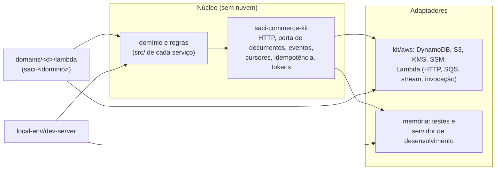
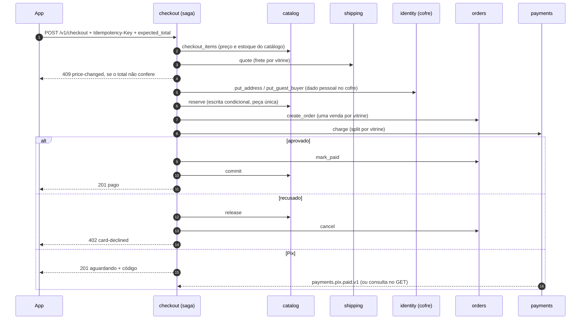

# Arquitetura do saci-commerce

Como os domínios da vitrine, da compra e do painel do artesão rodam: serviços, funções, dados, eventos e o caminho de uma requisição. As decisões estão nos [ADRs](adr/); a base é a [proposta do back-end](../../saci-sume/back-end-proposta.md).

## Camadas

- **Núcleo**: cada serviço escreve regras e rotas contra portas do kit (`DocumentStore`, `ObjectStore`, `InternalClient`, `TokenSigner`, `GrantStore`...). Nenhum serviço importa um SDK de nuvem fora da feature `aws`.
- **HTTP sem framework**: `Request`/`Response` simples e roteamento por *slice patterns* (`("GET", ["v1", "catalog", "listings", id])`), o que mantém o binário pequeno e o *cold start* curto.
- **Plataforma**: erros RFC 9457 (`saci-problem`), contexto do autorizador e níveis de acesso (`saci-authz`), ids com prefixo (`saci-ids`), CloudEvents sem dado pessoal (`saci-events`), *outbox* (`saci-outbox`), idempotência (`saci-idempotency`), logs mascarados (`saci-telemetry`).

## Funções (Lambdas)

Um binário por domínio, uma função por papel ([ADR 0003](adr/0003-binario-por-dominio-funcao-por-papel.md)). Cada função tem papel IAM próprio, só com o que precisa, e escala sozinha.

| Domínio | Funções |
| --- | --- |
| `catalog` | `api`, `search` (512 MB, projeção em memória), `internal` (estoque), `search-internal`, `indexer`, `artisans`, `relay`, `migrate` |
| `sellers` | `api`, `internal`, `workspace` (contagens do painel, convites), `relay`, `migrate` |
| `customers` | `api`, `profiles` |
| `reviews` | `api`, `migrate` |
| `media` | `api`, `internal`, `pipeline` (1,5 GB, tamanhos em paralelo), `relay` |
| `shipping` | `api`, `internal`, `labels`, `hooks` (transportadora, mTLS), `relay` |
| `checkout` | `api` (a saga), `payments`, `sweeper` (a cada 5 min), `relay` |
| `orders` | `api`, `internal`, `progress`, `relay`, `migrate` |
| `support` | `api`, `internal`, `handoffs`, `relay`, `migrate` |
| `notifications` | `api`, `dispatcher`, `push-sender` |

**O que corre em paralelo**: leitura pública (`search`) e escrita (`api`) escalam separadas; cada consumidor de eventos tem fila própria e processa em lote com falha parcial; a esteira de imagens gera os tamanhos em threads e é limitada por concorrência reservada; o envio de avisos sai do consumo de eventos para uma fila própria (`push-sender`).

## Dados

Cada serviço tem tabela e chave KMS próprias (seção 7.4). Desenho de tabela única, documentos JSON por `pk`/`sk`, índices escritos na mesma transação ([ADR 0006](adr/0006-dynamodb-com-porta-de-documentos.md)).

| Tabela | Classe | Conteúdo |
| --- | --- | --- |
| `saci-<env>-catalog` | C1 | anúncios, estoque e reservas, perfis do diretório, categorias, atributos |
| `saci-<env>-catalog-search` | C0 | projeção pública da busca (refeita do zero com `rebuild`) |
| `saci-<env>-sellers` | C2 | vitrines, endereços (URL e redirecionamento), equipe, convites, conferências, contagens |
| `saci-<env>-customers` | C2 | nome preferido, **referência** do endereço, favoritos, novidades |
| `saci-<env>-reviews` | C2 | avaliações, resumo das notas |
| `saci-<env>-media` | C1 | estado dos envios |
| `saci-<env>-shipping` | C1 | etiquetas (referência ao PDF em `files.`), rastreios |
| `saci-<env>-checkout` | C2 | idempotência e estado das sagas (só ids e referências) |
| `saci-<env>-orders` | C2 | pedidos, vendas por vitrine, índices do painel |
| `saci-<env>-support` | C2 | chamados e mensagens mascaradas |
| `saci-<env>-notifications` | C2 | aparelhos e preferências |

**CPF, contato e endereço não ficam aqui** (D9, seção 9.3): vão para o cofre do `saci-identity` e este repositório guarda só a referência `addr_…`, aberta na hora por quem pode (a vitrine só em `awaiting_shipment`, a etiqueta ao ser gerada).

## Eventos

Publicados pelo *outbox* (mesma transação do dado → stream → função `relay` → EventBridge da plataforma) e consumidos por filas próprias, com deduplicação pelo `id` do CloudEvent. Os tipos são os de `saci-contracts/events`.

| Publica | Eventos |
| --- | --- |
| `catalog` | `catalog.listing.{published,updated,paused,withdrawn}.v1`, `catalog.stock.changed.v1` |
| `sellers` | `sellers.storefront.{opened,updated}.v1`, `sellers.team.member_changed.v1` |
| `media` | `media.upload.{ready,rejected}.v1` |
| `shipping` | `shipping.label.purchased.v1`, `shipping.tracking.updated.v1` |
| `checkout` | `checkout.order.{confirmed,abandoned}.v1` |
| `orders` | `orders.sale.{ready,shipped,delivered}.v1` |
| `support` | `support.ticket.{opened,message_added,resolved}.v1` |

## Uma compra, ponta a ponta

Chamadas síncronas internas: invocação direta da função `*-internal` do outro domínio, com IAM ([ADR 0004](adr/0004-chamadas-internas-por-invocacao.md)). A saga roda em Rust com compensação e varredura ([ADR 0007](adr/0007-saga-em-rust.md)).

## Segurança aplicada (achados da seção 6.1)

| Achado | Onde |
| --- | --- |
| S-01 endereço do ateliê na rota pública | `sellers-api`: `PublicStorefront` só com cidade, UF e país; o endereço é aberto no cofre só na rota privada |
| S-04 convite revela nome | `sellers-api`: convite sempre `invited`, sem nome; nome só no aceite; 20 convites por vitrine por dia |
| S-05 teste de datas de nascimento | `sellers-api`: 5 conferências por conta em 24 h (`attempts-exceeded`) |
| S-06 cobrança dupla | `kit::idempotency` no checkout, anúncio novo, resposta a chamado e avaliação |
| S-07 injeção pela descrição | `kit::text::listing_violation`: sem contato, link nem preço no anúncio |
| S-09 etiqueta previsível | `shipping-api`: PDF privado em `files.`, URL assinada de 5 minutos a cada pedido |
| S-10 valores para a equipe | `orders-api`: `payment` só para a pessoa responsável |
| S-14 imagens não verificadas | `media`: tamanho e SHA-256 presos à assinatura, quarentena, GuardDuty, reescrita sem EXIF |
| S-20 raspagem | máximos de `ids` (24) e `limit` (48); limites por IP e conta (`kit::limits`) além do WAF |
| S-21 endereço de vitrine tomado | nomes reservados e proibidos; endereço antigo redireciona e fica reservado por 12 meses |
| S-22 imagens de outro host | `sellers-api`: logotipo e capa só do CDN em produção |
| S-23 chamado com dado pessoal | `support-api`: textos de quem compra mascarados (`saci-mask`) |
| BOLA (API1) | objeto de outra conta ou vitrine é sempre 404; a vitrine vem do token, nunca da URL |

## O que falta (fora deste repositório ou decisão pendente)

| Item | Situação |
| --- | --- |
| `saci-identity`, `saci-payments`, `saci-finance`, `saci-assistant` | Ainda não existem. Os alvos internos correspondentes são atendidos pelo **sandbox** fora de produção; o que cada um precisa oferecer está em [contratos-internos.md](contratos-internos.md) |
| Contratos HTTP de `checkout`, `orders`, `media`, `support`, `notifications` | A escrever em `saci-contracts` (etapas 3 e 4); a implementação segue a proposta (seção 5) e os tipos da interface |
| Autorizador opcional | `POST /v1/checkout` é público na borda e a função confere a conta com o código do autorizador; um autorizador "opcional" na plataforma simplificaria |
| Workflow de implantação | O reutilizável da plataforma precisa clonar o `saci-boiuna` ao lado ou a plataforma publicar a tag `v0.1.0` ([ADR 0002](adr/0002-plataforma-clonada-ao-lado.md)) |
| Transportadora e base de CEP | Tabela de faixas e regra do mock até haver contrato e saída para a internet |
| Envio ao Expo Push | Registrado em log até a saída para `exp.host` ser liberada no firewall |
| Fotos nas avaliações | Depende de uma rota de envio para quem compra (a de `media` é do painel) |
